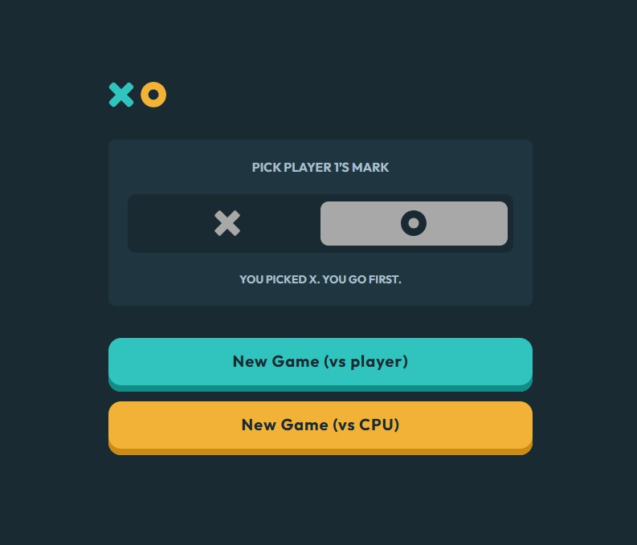

# Frontend Mentor - Tic Tac Toe solution

A browser-based Tic Tac Toe game built with semantic HTML, CSS authored in SCSS, and vanilla JavaScript. Players can share a device for a two-player match or play against a computer that uses minimax to choose its moves.

## Table of contents

- Overview
- My process
- What I learned
- Continued development

## Overview

### The challenge

The project implements the Frontend Mentor Tic Tac Toe challenge, including local multiplayer, solo play, browser persistence, and a computer opponent that can block threats and choose winning moves.

The interface uses a mobile-first layout with hover feedback and visible keyboard focus styles. Visual accuracy and accessibility require separate browser checks beyond successful compilation.

### Game behavior

- Choose X or O for Player 1. The other mark belongs to Player 2 or the CPU.
- X starts the first round. The starting mark alternates between O and X in subsequent rounds.
- Track X wins, O wins, and ties across rounds.
- Show a result dialog after a win or tie. Next round starts another round; Quit returns to the menu and clears the saved match.
- Open a confirmation dialog before restarting. Confirmation clears the current board while preserving scores and the current round's starting mark; cancellation resumes play.
- Restore the board, scores, selected mark, and round state after a refresh when browser storage is available.
- Update the selection hint immediately: X displays `You picked X. You go first.`; O displays `You picked O. X goes first.`

### Screenshot



### Links

- Solution URL: [Repository](https://github.com/jonghwascript/tic-tac-toe)
- Live Site URL: [Live site](https://jonghwascript.github.io/tic-tac-toe/)

## My process

### Built with

- Semantic HTML, native radio inputs, buttons, and dialog elements
- CSS custom properties and SCSS variables, mixins, and placeholders
- CSS Grid for the board and Flexbox for component layout
- Mobile-first media queries and logical properties
- rem typography and spacing, with em for text-related icon sizes and letter spacing
- Vanilla JavaScript, DOM events, localStorage, and minimax

### Implementation approach

The interface is divided into a new-game menu, game board, and dialogs. HTML provides native controls and accessible names. CSS manages layout, component appearance, and interaction states. JavaScript maintains a single match state and renders the board, turn indicator, scores, and dialogs from that state.

Page styles live in `src/scss/pages/_home.scss`. The SCSS entry point imports the base, layout, component, page, and utility modules, with utilities last. Class prefixes distinguish layout (`l-`), components (`c-`), and utilities (`u-`).

## What I learned

### HTML: native controls and accessible state

X and O are mutually exclusive choices, so they use native radio inputs. Visually hiding an input with `.u-sr-only` preserves keyboard access, while the associated label provides the visual selection and focus treatment.

Each board cell is a native button with a name describing its row, column, and current mark. JavaScript keeps that name synchronized with the visible state. The board uses `role="group"`; CSS Grid controls its visual layout without requiring an ARIA grid interaction model.

```html
<button class="c-board__cell"
  type="button"
  aria-label="Row 1, column 2, empty">
</button>
```

Occupied cells and cells locked during the CPU turn use `aria-disabled` with an explicit JavaScript activation guard. All nine cells remain in the tab order so players can inspect the position, and the activated cell retains focus while the CPU responds.

The turn indicator combines `role="status"`, `aria-atomic="true"`, and visually hidden text naming the current mark. Score outputs are connected to their visible labels with `aria-labelledby`. Decorative SVGs are hidden from assistive technology; the restart button and logo receive their own accessible names.

Native dialogs handle modal presentation. JavaScript selects the appropriate result title, closes any sample dialog state during initialization, and moves focus to the first board cell when a round begins. Selection hints use a polite live region. Actual screen reader announcements still require verification.

### CSS: flexible layout and the cascade

Grid tracks need `minmax(0, 1fr)` to shrink below their automatic content minimum. Board cells also use `min-inline-size: 0` and a square aspect ratio. Marks are capped at 70% of a cell's width so they can fit smaller cells.

```scss
.c-board {
  grid-template-columns: repeat(3, minmax(0, 1fr));
  gap: 1.25rem;
}

.c-board__cell {
  min-inline-size: 0;
  aspect-ratio: 1;
}
```

Score cards use `flex: 1 1 0` and `min-inline-size: 0` to share available width. A minimum block size lets their height grow when labels wrap. Shrinking the cards does not guarantee that long labels or scores fit; enlarged text needs separate checks.

Sass places selectors extended with `@extend` at the placeholder's declaration. Shared variant placeholders appear after base button rules so their declarations can override the base styles. The `.u-hidden` utility provides explicit hiding without depending on a weaker tag selector.

Enabled cells receive hover feedback only on devices that support hover. Focus outlines, forced-color borders, and system focus colors provide additional visual cues, but the presence of these styles does not prove accessibility conformance.

### CSS: choosing rem, em, and px

Units are chosen according to what should scale when the user increases the font size.

| Unit | Use in this project | Reference |
| --- | --- | --- |
| rem | Font sizes, component spacing, padding, and selected dimensions | Root font size |
| em | Text-adjacent icons, icon gaps, and button letter spacing | The element's own font size |
| em in media queries | Responsive breakpoints | Browser default font size |
| px | Borders, focus outlines and offsets, shadows, and visually hidden 1px areas | Fixed CSS length |
| %, fr, and viewport units | Available space and fluid layout | Parent or viewport dimensions |

For a design calibrated to a 16px root, divide the design's pixel value by 16 to obtain rem. Actual rem dimensions continue to depend on the root font size.

For ordinary dimensions and spacing:

```text
em value = desired pixel size / the element's font size in pixels
actual pixel size = em value * the element's font size in pixels
```

A 20px icon next to a 16px font is `1.25em`. The same value becomes 30px when that element's font size is 24px. The em unit on `font-size` is different: it uses the parent's font size.

The turn icon uses `1.142857em` at a 14px font and `1.25em` at a 16px font. Result icons inherit a 1.5rem font from their parent and use `1.25em` for their dimensions. Button letter spacing is `0.05em` for the default 20px font and `0.0625em` for compact buttons with a 16px font.

Breakpoint tokens retain the design values of 768px and 1024px; the media-query mixin converts them to 48em and 64em. Changing only the root font size does not reproduce a change to the browser's default font setting for these queries.

Relative units alone do not prevent overflow. Large margins can consume too much space on narrow screens, so viewport-limited spacing and wrapping should be evaluated where needed.

### JavaScript: game state and rendering

The match state records the mode, Player 1's mark, starting mark, current turn, nine-cell board, round result, and cumulative scores. A completed round increments its score once and prevents further moves. Starting the next round alternates the starting mark; restarting preserves it.

Rendering updates cell classes, aria-disabled states, accessible names, turn graphics, score labels, and result messages together. This keeps the visible interface consistent with the stored state.

### JavaScript: a predictable computer opponent

Minimax explores the remaining legal moves and evaluates terminal boards. Wins score positively, losses negatively, and ties score zero from the CPU's perspective. Depth adjustments favor faster wins and delay unavoidable losses.

The CPU acts after a short timer. Human input is blocked during its turn. Opening restart confirmation cancels the pending timer; closing it schedules a move again when appropriate. Round resets and quitting also clear pending moves.

### JavaScript: persistence and recovery

The match is stored under `tic-tac-toe-v1` in localStorage. Restoration checks the mode, marks, board shape, score values, move counts, turn, and result before accepting the saved state. Malformed data is ignored, and storage failures leave the current game playable.

After restoration, the selected radio and its hint are synchronized with the restored player mark. Completed rounds reopen their result dialog without adding to the score again.

## Continued development

- Compare computed styles and element sizes after the relative-unit changes, including both sides of each breakpoint.
- Check narrow screens, long scores, landscape layouts, browser default font changes, and 200% text enlargement.
- Recheck the final interface in Chrome and Firefox, including dialog focus, keyboard navigation, screen reader announcements, and Windows high-contrast mode.
- Review the result dialog's horizontal margins so enlarged text retains enough room for its buttons.

Earlier Chrome checks covered wins, ties, scores, alternating starters, restart confirmation and cancellation, quitting, refresh restoration, CPU timing, and selection hints. A separate CPU logic check covered 1,226 terminal paths across both CPU marks and both starting marks without a CPU loss. These checks describe the implementation at the time they ran; they do not establish visual accuracy or full accessibility after subsequent CSS changes.
